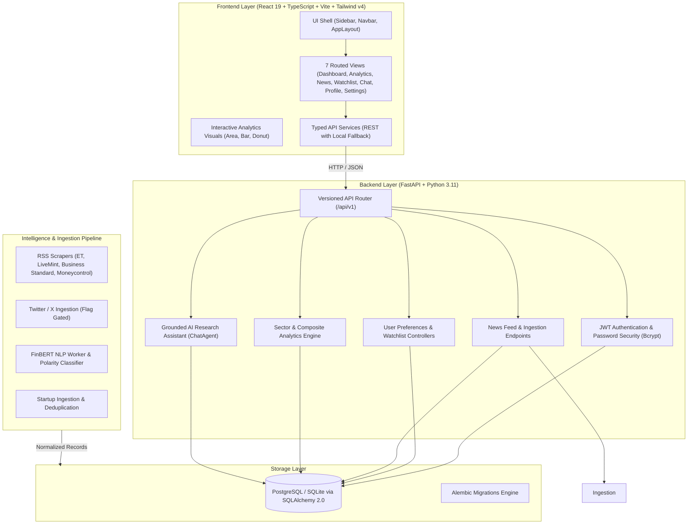
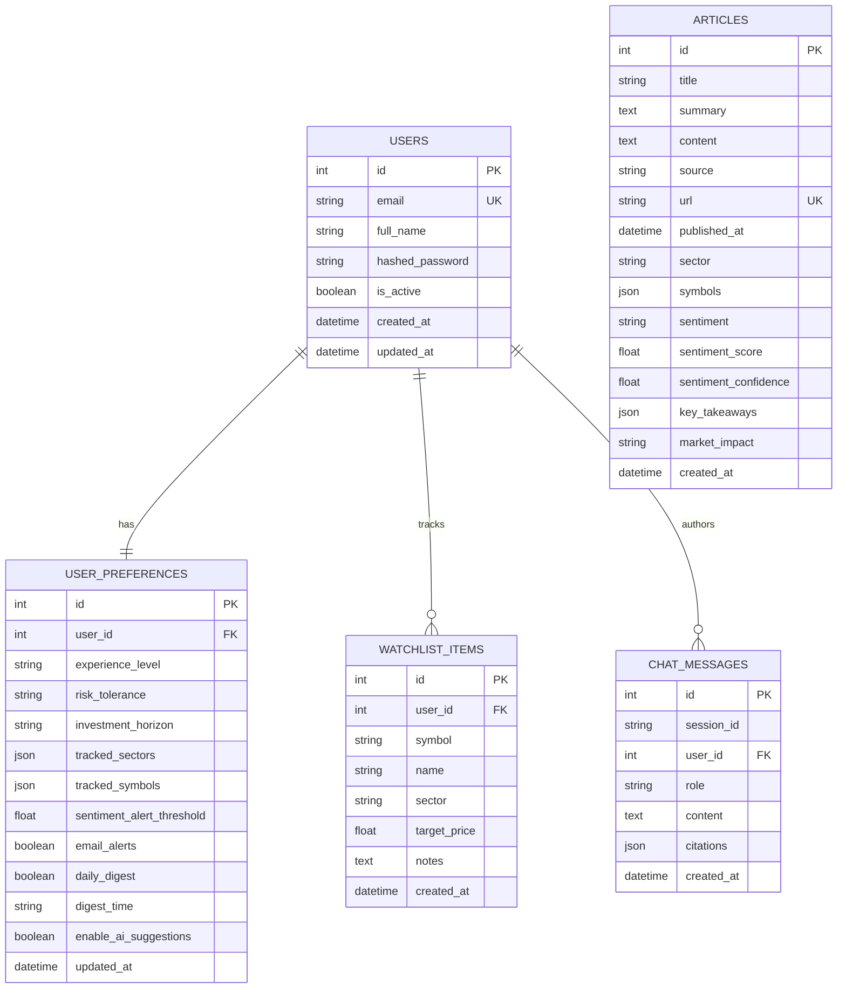
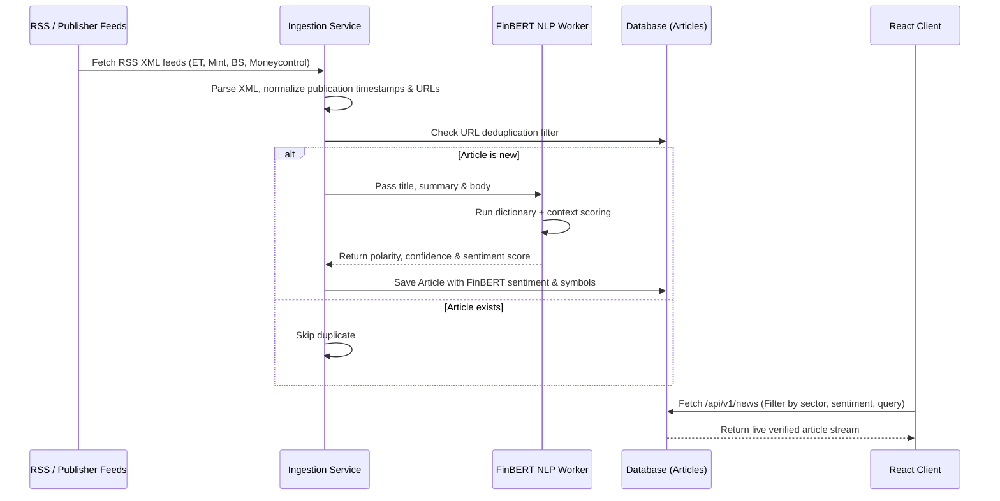

# Emvest: Comprehensive Architecture Specification

## 1. System Overview

Emvest is an agentic investment intelligence and financial NLP platform built for Indian equities and market sectors. It combines real-time multi-publisher RSS ingestion, financial sentiment analysis with FinBERT, interactive portfolio and sector analytics, and a grounded conversational AI assistant with verifiable citations.

---

## 2. Technology Stack

### Frontend Architecture
- **Framework:** React 19 (`react`, `react-dom`)
- **Language:** TypeScript 5.8+ / 6.0
- **Build Tool:** Vite 8.3.6 with `@tailwindcss/vite`
- **Styling:** Tailwind CSS v4 (Modern CSS variables, OKLCH color space, zero-config utility classes)
- **Routing:** React Router 7 (`react-router-dom`)
- **Data Visualization:** Recharts 2.15 (ResponsiveContainer, AreaChart, BarChart, PieChart)
- **Linting & Quality:** ESLint 10 with `typescript-eslint`

### Backend Architecture
- **Web Framework:** FastAPI (Asynchronous ASGI framework with OpenAPI / Swagger UI auto-generation)
- **Runtime:** Python 3.11+ running inside Conda environment `emvest`
- **Configuration:** `pydantic-settings` (v2) with `.env` file loading
- **Data Serialization:** Pydantic v2 schemas (`model_config = ConfigDict(from_attributes=True)`)
- **Database ORM:** SQLAlchemy 2.0 (Declarative Base, Scoped Sessions)
- **Database Engine:** SQLite for zero-setup local dev (`emvest.db`) / PostgreSQL for production
- **Migrations:** Alembic
- **Security:** `bcrypt` native password hashing + `PyJWT` authentication
- **Test Framework:** Pytest 8.4 + HTTPX (`TestClient`)

---

## 3. Database Schema & Entity Relationships

---

## 4. Pipeline & Ingestion Architecture

---

## 5. Grounded AI Assistant (RAG Engine)

The AI assistant operates on a strict **Retrieval-Augmented Generation (RAG)** model with verifiable citations:

1. **Entity Extraction:** When a user queries (e.g., *"What is the outlook for Tata Motors electric vehicles?"*), the agent identifies equity symbols (`TATAMOTORS`), sectors (`Automobile & Auto Ancillary`), and macroeconomic keywords.
2. **Database Retrieval:** Retrieves stored articles matching the detected entities or semantic text from the `articles` table, ranked by relevance and recency.
3. **Sentiment Synthesis:** Aggregates individual FinBERT sentiment scores across matching articles to calculate a composite conviction metric.
4. **Grounded Answer Synthesis:** Formulates structured findings, key takeaways, and market impact using only the retrieved evidence.
5. **Verifiable Citations:** Returns structured citation cards containing article IDs, publisher names, URLs, publication dates, and FinBERT scores.
6. **Persistence:** Saves both query and answer into `chat_messages` under a unique session identifier.

---

## 6. Security & Credential Boundary

- **API Keys:** External LLM and Twitter credentials (`GEMINI_API_KEY`, `OPENAI_API_KEY`, `TWITTER_BEARER_TOKEN`) reside strictly in backend environment variables. The client never receives or transmits API keys.
- **Passwords:** Passwords hashed with salted bcrypt rounds (12 passes) and verified via constant-time checks. Passwords truncated to 72 bytes to prevent bcrypt wraparound attacks.
- **Tokens:** JWTs issued with standard claims (`sub`, `user_id`, `exp`) and validated via FastAPI OAuth2 dependency injection.
- **CORS Protection:** Configured with whitelisted development and production client origins.
- **Database Safety:** SQLAlchemy ORM parameterization guarantees protection against SQL injection.
